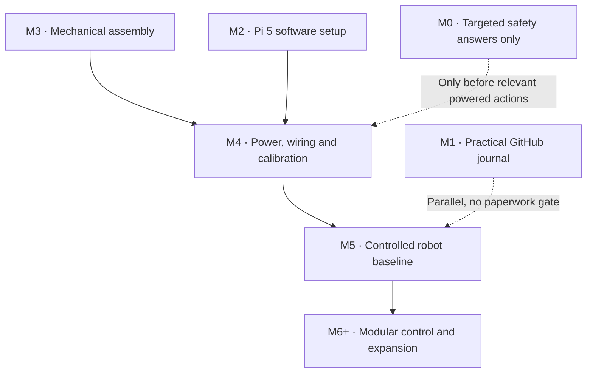

# PiCar-X V4 + Raspberry Pi 5 — Master Roadmap

**Version:** 2.2 · **Original baseline:** 2026-11-19 · **PACE decisions approved:** 2026-11-20  
**Language:** English · **Technical scope:** M0–M13+ unchanged  
**Operating principle:** Progress first. No audits, evidence submission, inventory paperwork, photographs or completed checklists are required for project progress.

> **Purpose:** Build → Understand → Test → Measure → Document → Improve → Repeat.  
> **Status authority:** `PROJECT_STATE.md` and the user's latest statements. A user-reported DONE is accepted as DONE, without demands for proof. This roadmap is the technical plan, not a competing progress ledger.

## 1. Approved baseline and engineering pillars

- **User-confirmed:** SunFounder **PiCar-X V4** kit received.
- **Approved/planned:** Raspberry Pi 5 (actual variant when reported); Linux Mint + VS Code + Git/GitHub; Raspberry Pi OS **64-bit**; Python primary.
- **User-reported:** GitHub repository and initial commit exist. Preserve existing work; do not start duplicate repository tasks.
- **D1 — GitHub engineering journal:** working code, useful configuration, nontrivial wiring/BOM and decisions, meaningful Issues/PRs/Releases when useful; no administrative micro-logging.
- **D2 — Telemetry:** battery/power where measurable, CPU/RAM, temperature, sensors, response and network latency, failures; retain units and conditions where measurements actually exist.
- **D3 — Safety Controller:** validate control requests, speed/motion limits, watchdog/timeouts, emergency-stop behavior and fail-safe response to lost link. Software stopping is not independent physical drive-power isolation.
- **D4 — Hybrid AI:** Pi 5 performs local motion execution and enforces safety; PC/CUDA, local LLM/VLM and/or API provide heavier computation, never a motion-safety override.
- **D5 — Pico 2 W:** future embedded sensing/timing option if compatibility and measurable value over Robot HAT justify it.

**Do not confuse approved technical direction with completed hardware/software.** For actual task status accept the user's report without demanding supporting material.

## 2. PACE — governing execution method

**PREDICT → ACT → CHECK → EVOLVE**

- **Predict:** NOW, NEXT, LOOK AHEAD; prepare at least one, ideally two probable next steps and their prerequisites; no unsupported probabilities.
- **Act:** prioritize assembly and first control; prepare Pi 5 OS and software in parallel; do the assistant-side planning/coding/research rather than shifting unnecessary work onto the user.
- **Check:** the user performs only relevant technical/safety checks as part of the physical procedure; **never demand evidence, reports, photos, logs, checklists or an administrative approval gate**. Acknowledge what the user says is complete.
- **Evolve:** continue upon success; on failure test a new hypothesis, correct or work around the issue; no repeated diagnostics without new information.

**Anti-loop filter:** Goal → Already done? → Real dependency? → Material safety risk? → Next. Skip steps that do not contribute.

**Decision precedence:** latest explicit user instruction > newer approved decision/document > earlier compatible decisions > context > assistant proposals. Later versions supersede older *conflicting procedures*; they cannot change a measured value or electrical rating merely by being newer. PACE supersedes the former audit-first workflow.

### Critical path (milestone numbers preserved)

M0 is *not* a prerequisite for safe unpowered M3 steps. M2 may proceed independently. Stop before a powered step **only** if a genuine unresolved electrical/safety condition makes that action unsafe. Do not convert a safety instruction into a demand for proof.

## 3. Technical milestones — outcomes, not administrative gates

### M0 — Inventory, revisions, BOM and safety (targeted; not audit-first)
**Work:** Identify a component, actual Robot HAT revision, connector, power interface or missing item **only when needed for the next step or a useful purchase decision**. Maintain optional practical BOM; no full count, per-part photographs or obligatory inventory document. Resolve genuine power uncertainty before energizing, not before harmless mechanical work.

**Useful outcome:** The next physical action can be completed safely. No mandatory M0 sign-off, checklist or GitHub Issue.

### M1 — GitHub foundation and engineering journal (parallel)
**Work:** Continue the **already reported** repository/commit workflow; do not recreate work. Maintain an independent repo from SunFounder upstream. Capture useful code, configuration, bugs/fixes and working milestones. Issue → branch → code → test → PR → review → merge/release when the change justifies it; small changes can stay simple.

**Useful outcome:** Work is protected and meaningful results are reproducible, without every assembly step needing a commit.

### M2 — Raspberry Pi 5, Linux and Python foundation
**Work:** Prepare Raspberry Pi OS **64-bit**, boot medium, network/SSH, Python and revision-compatible SunFounder `robot-hat`, `picar-x` and `vilib` dependencies. Check current upstream versions before installation. Create a small reusable setup script when it reduces repetition. Keep PC versus Pi commands distinct.

**Useful outcome:** The user reports boot/network/Python work ready for the next servo/control step. Preserve actual working configuration when available; no compulsory setup report.

### M3 — Mechanical assembly and servo alignment
**Work:** Assemble chassis, drivetrain, steering, camera mounts and sensible cable routes from the supplied printed booklet. Follow the physical orientation/revision where relevant. **Zero servos before fitting horns** using the correct powered procedure; if needed, proceed with other unpowered assembly while servo power arrangements are unresolved. Never force a binding mechanism.

**Useful outcome:** User reports the assembly step done and mechanisms free of obvious interference. No photo, screw inventory, checklist or stage-completion proof.

### M4 — Wiring, power, calibration and controlled actuator tests
**Work:** Before applying power, establish the appropriate board/connector and permissible supply, polarity, charging and Pi 5 load arrangement from the applicable instructions. Connect relevant motors, servos and installed sensors accordingly. Set steering/pan/tilt and motor direction, calibrate where necessary. First motor tests at low speed with wheels **raised** and a reliable stop.

**Useful outcome:** User reports safe responsive actuators/steering and can proceed. No mandatory evidence upload or test report.

### M5 — First functional robot and baseline
**Work:** Controlled startup/shutdown; forward, reverse, steering and stop. Check installed camera/ultrasonic/grayscale sensors as applicable. Preserve a known-working configuration, address blocking faults and keep the first useful milestone on GitHub.

**Useful outcome:** User reports repeatable basic control and stopping. **Planned Git release tag remains `v0.1.0`** — Functional Robot Baseline. The description "Robot Baseline v1.0" does not rename this tag.

### M6 — Modular Python control
**Work:** Isolate drive, sensing and command interfaces; add error handling, manual control and optional remote UI. Use lightweight mock/unit tests and practical integration tests when useful.

**Useful outcome:** Maintainable control API and reliable manual command execution, with no artificial reporting workload.

### M7 — Telemetry and comprehensive Safety Controller
**Work:** Measure available battery/power, CPU/RAM, thermals, sensors, latency and faults; implement bounded control commands, speed/motion limits, heartbeat/watchdog, timeouts, stop modes and safe reconnection. Distinguish normal stop, software emergency stop and independent physical drive-power isolation. Basic stop must exist **before M5 driving**, and lost-link protection before autonomous driving.

**Useful outcome:** User-reported working safety/telemetry behavior; planned tag `v0.2.0` — Safe & Observable Robot after relevant functional testing.

### M8 — Sensors and basic autonomy
**Work:** Line following, obstacle detection/avoidance and calibrated simple rule-based behavior using installed sensors. Maintain manual override and local safety. Test in a controlled environment and improve failures.

**Useful outcome:** Repeatable autonomous behavior appropriate to the available equipment.

### M9 — Computer vision and local AI
**Work:** Camera streaming, OpenCV/`vilib`, detection and tracking, feasible local inference; measure frame rate, latency, CPU/RAM, thermals and power when relevant. Evaluate hardware acceleration for compatibility and real advantage rather than novelty.

**Useful outcome:** Stable useful perception; **planned tag after M8+M9:** `v0.3.0` — Perception & Basic Autonomy.

### M10 — Hybrid AI: Pi 5 + PC / LLM / VLM / API
**Work:** Bounded/authenticated communication with PC/CUDA, local LLM/VLM or API. Pi 5 interprets external AI as untrusted requests, validates them and performs local motion. Compare inference locations when meaningful; protect against stale responses and loss of connection.

**Useful outcome:** AI-assisted behavior without bypassing Pi-side safety.

### M11 — Pico 2 W and embedded integration
**Work:** If justified, prototype MicroPython/C/C++ sensing or timing functions; confirm voltage, power, GPIO/UART/I²C/USB compatibility and disconnection behavior. Compare with Robot HAT onboard MCU.

**Useful outcome:** Only retain the extension if it demonstrates practical added value; purchases require approval.

### M12 — Advanced robotics and ROS 2
**Work:** Evaluate ROS 2, odometry, encoders, fusion, localization, mapping/SLAM, navigation and simulation, with explicit attention to missing hardware capabilities and performance limits.

**Useful outcome:** Useful repeatable robotics demonstration, not a documentation-only milestone.

### M13+ — Open-ended research, upgrades and new platforms
**Work:** Explore digital twins, advanced vision-language systems, custom sensing/PCBs, distributed AI, different platforms or other research while keeping a stable working configuration available.

**Useful outcome:** Reproducible practical learning and measured improvements when meaningful, without an artificial project endpoint.

## 4. Engineering and GitHub practices

- Protect all local/untracked/unpushed work before pull, sync, merge, rebase or reset. Never treat remote as superior. Destructive resets, force push, overwrite, deletion or history rewrite require **explicit approval**. Prefer backup and reversibility. No secrets in commits.
- Keep stable and experimental work separate when useful. Record dependency revision/commit SHA, configuration or test details only when they matter to reproduce a meaningful result.
- Keep drive, sensing, control, safety, telemetry, communications and AI behind clear software interfaces as components grow. Use simple tests, mocking and controlled hardware testing when valuable; do not demand formal test IDs or report packages.
- Consider microphone/voice, M.2 HAT+/NVMe, AI HAT+ 2, extra sensors, Pico 2 W, ROS 2 or offboard CUDA based on compatibility, power, thermals, benefit and cost. Purchases/major rebuilds remain subject to approval.
- **Automation, at the point of value:** Pi 5 setup script for repeatability, read-only diagnostic script after first boot, small motor/sensor test runner when needed, CI when custom code exists, and richer telemetry after the functional baseline. Do not automate chaos or build dashboards before there is data.
- Update `PROJECT_STATE.md` when the user reports meaningful progress or a true blocker. Do not duplicate a progress record into multiple active documents.

## 5. Electrical and mechanical safety — practical, not administrative

Manufacturer documentation differs across versions and possibly supply interfaces: the general PiCar-X page mentions **7–12 V**, while Robot HAT V4 documentation lists **6.0–8.4 V battery input**; **do not assume these refer to the same connector or revision**. Robot HAT V4 documentation also describes a **5 V / 3 A** output, while full Raspberry Pi 5 peripheral headroom may need a **5 A-capable supply**. These documents alone do not establish a safe power configuration. Use actual board markings/manual to select the correct path before connecting power. No guesswork about voltage or polarity.

Servo zeroing must use the revision-appropriate process **before fitting horns**. Test motors with wheels raised, low speed and a reliable immediate stop. A software emergency stop is distinct from physical drive-power isolation. Protect against stale remote commands and link loss before autonomous motion. Provide concise procedures, not audit paperwork or demands for measurements/photos to be sent to the assistant.

## 6. Immediate direction — NOW / NEXT / LOOK AHEAD

**NOW:** Continue safe unpowered M3 assembly according to the supplied manual; work on M2 OS/software independently when the necessary Pi 5 hardware is available. Neither activity requires a full M0 inventory or GitHub status paperwork.

**NEXT:** Prepare actual-board power/servo procedure at the point of energized connection; zero servos before horns; carry out controlled first tests with safe stop.

**LOOK AHEAD:** First forward/reverse/steering/stop baseline (M5), then useful code/config to GitHub, followed by modular control, sensing, safety and telemetry.

**GitHub:** No new entry is needed for every physical action or ordinary successful procedure.

## 7. Official technical references

- [SunFounder PiCar-X documentation](https://docs.sunfounder.com/projects/picar-x-v20/en/latest/) · [Assembly](https://docs.sunfounder.com/projects/picar-x-v20/en/latest/assemble.html) · [Servo zeroing](https://docs.sunfounder.com/projects/picar-x-v20/en/latest/python/py_servo_adjust.html) · [Calibration](https://docs.sunfounder.com/projects/picar-x-v20/en/latest/python/python_calibrate.html)
- [SunFounder PiCar-X source](https://github.com/sunfounder/picar-x) · [Robot HAT source](https://github.com/sunfounder/robot-hat) · [`vilib`](https://github.com/sunfounder/vilib)
- [Robot HAT series docs](https://docs.sunfounder.com/projects/robot-hat-v4/en/latest/) · [V4 electrical specifications](https://docs.sunfounder.com/projects/robot-hat-v4/en/latest/robot_hat_v4/features.html)
- [Raspberry Pi hardware and power documentation](https://www.raspberrypi.com/documentation/computers/raspberry-pi.html#power-supply)

**Record-keeping:** Relevant user-reported progress is accepted without evidence. Actual technical safety rules and applicable manufacturer specifications remain in force. This file does not claim the assistant has independently operated or tested the robot.
